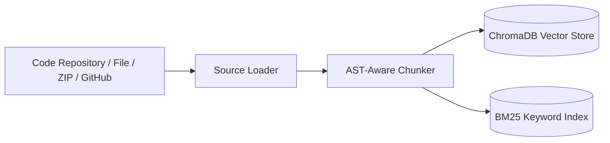
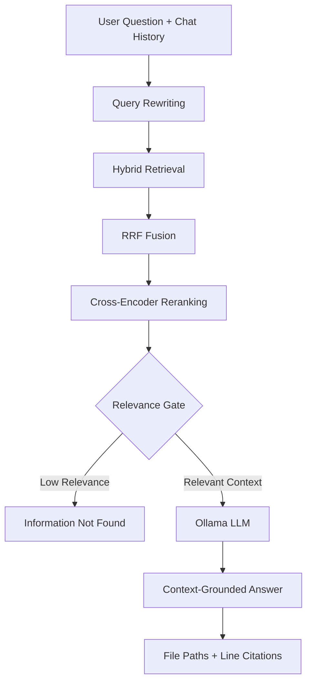

# 🧠 RepoMind – Ask Your Codebase Anything

**RepoMind** is a local, privacy-first AI-powered application that lets developers interact with their codebase using natural language.

Simply provide a local repository, upload a file, or enter a public GitHub URL, and start asking questions about your code. RepoMind retrieves relevant code snippets and generates answers grounded in the actual source code, with **file paths and line-number citations** for every claim.

🔒 **Privacy First:** All processing happens locally on your machine. Embeddings, retrieval, reranking, and LLM inference run locally using Ollama. Your source code is not sent to a cloud LLM service.

---

## ✨ Key Features

- **Multiple Input Sources:** Supports local folders, individual files, ZIP archives, uploaded files, and public GitHub repositories, including specific branches and subfolders.
- **AST-Aware Code Chunking:** Uses Tree-sitter to split source code based on meaningful programming structures such as functions and classes, with a LangChain fallback.
- **Hybrid Retrieval:** Combines BM25 keyword search and ChromaDB semantic search using Reciprocal Rank Fusion (RRF).
- **Cross-Encoder Reranking:** Re-evaluates retrieved code chunks to improve relevance and answer accuracy.
- **Anti-Hallucination Mechanism:** Uses a relevance gate and context-restricted prompts to reduce unsupported answers.
- **Source Code Citations:** Generates answers with file paths and line-number references.
- **Multi-Turn Conversations:** Understands follow-up questions by rewriting them into standalone search queries using conversation history.
- **Streaming Chat Interface:** Built with Streamlit, featuring expandable source snippets, light/dark themes, and Ollama health checks.
- **Smart Index Caching:** Reuses saved indexes for unchanged repositories to reduce indexing time.

---

## 🏗️ System Architecture

RepoMind follows a Retrieval-Augmented Generation (RAG) pipeline to understand and answer questions about source code.

### 1. Repository Indexing

This process runs when a repository is added for the first time.



**How it works:**

1. **Source Loader:** Loads source code from a local folder, file, ZIP archive, or public GitHub repository.
2. **AST-Aware Chunker:** Splits source code into meaningful chunks using Tree-sitter.
3. **ChromaDB:** Generates and stores vector embeddings for semantic search.
4. **BM25:** Builds a keyword-based index to identify exact function names, variables, and identifiers.

### 2. Question Answering Pipeline

This process runs whenever a user asks a question.



**How it works:**

1. **Query Rewriting:** Converts follow-up questions into standalone queries using previous conversation context.
2. **Hybrid Retrieval:** Searches the codebase using both BM25 keyword search and ChromaDB semantic search.
3. **RRF Fusion:** Combines the results from both retrieval methods into a unified ranking.
4. **Cross-Encoder Reranking:** Re-scores retrieved chunks to prioritize the most relevant code.
5. **Relevance Gate:** Checks whether the retrieved context is sufficiently relevant. If not, the system returns an information-not-found response without calling the LLM.
6. **LLM Generation:** Sends relevant code context to the locally running Ollama model.
7. **Citation Generation:** Produces an answer with references to the corresponding source files and line numbers.

---

## 📥 Supported Inputs

| Input Type                | Example                                       |
| ------------------------- | --------------------------------------------- |
| Local Folder              | `./my-project`                                |
| Individual File           | `./app.py`                                    |
| ZIP Archive               | `C:/Users/you/app.zip`                        |
| Uploaded File             | Upload through the Streamlit interface        |
| Public GitHub Repository  | `https://github.com/owner/repo`               |
| GitHub Branch / Subfolder | `https://github.com/owner/repo/tree/main/src` |

### Supported File Types

Python, C#, JavaScript, TypeScript, Java, Go, Rust, C/C++, HTML, CSS/SCSS, JSON, YAML, SQL, Markdown, and reStructuredText.

### Processing Limits

- Files larger than 1 MB are skipped.
- ZIP archives support up to 20,000 files and 500 MB.
- Lock files and minified assets are ignored.

---

## 🛠️ Technology Stack

| Layer             | Technology                             | Purpose                                          |
| ----------------- | -------------------------------------- | ------------------------------------------------ |
| Frontend / UI     | Streamlit                              | Interactive chat interface                       |
| Code Parsing      | Tree-sitter                            | AST-aware code parsing and chunking              |
| Fallback Chunking | LangChain Text Splitters               | Text-based chunking fallback                     |
| Embeddings        | `BAAI/bge-small-en-v1.5`               | Converts code chunks into vector representations |
| Vector Database   | ChromaDB                               | Stores embeddings for semantic retrieval         |
| Keyword Retrieval | BM25                                   | Finds exact keywords and identifiers             |
| Result Fusion     | Reciprocal Rank Fusion (RRF)           | Combines keyword and semantic search results     |
| Reranking         | `cross-encoder/ms-marco-MiniLM-L-6-v2` | Improves retrieval relevance                     |
| LLM               | Ollama (`llama3.2:3b`)                 | Generates context-grounded answers locally       |
| Version Control   | Git                                    | Supports cloning public GitHub repositories      |

### Important Retrieval Techniques

- **BM25:** Identifies exact matches such as function names, class names, and variable identifiers.
- **Vector Search:** Finds code based on semantic similarity rather than exact word matching.
- **RRF:** Combines rankings from multiple retrieval methods.
- **Cross-Encoder:** Evaluates the relationship between the user's question and retrieved code chunks to improve ranking.

---

## 🚀 Getting Started

### Prerequisites

Make sure you have installed:

- Python 3.10 or later
- Git (required for GitHub repository URLs)
- [Ollama](https://ollama.com)

### 1. Clone the Repository

```bash
git clone <your-repo-url>
cd repomind
```

### 2. Create a Virtual Environment

```bash
python -m venv .venv
```

Activate it:

**Windows:**

```powershell
.venv\Scripts\activate
```

**Linux / macOS:**

```bash
source .venv/bin/activate
```

### 3. Install Dependencies

```bash
pip install -r requirements.txt
```

For AST-aware chunking, install the Tree-sitter packages:

```bash
pip install tree-sitter tree-sitter-language-pack
```

Without these grammars, the application can fall back to the text splitter.

### 4. Download the Ollama Model

```bash
ollama pull llama3.2:3b
```

### 5. Start Ollama

```bash
ollama serve
```

Skip this step if Ollama is already running.

### 6. Run RepoMind

```bash
streamlit run app.py
```

Open the URL displayed in your terminal, usually:

`http://localhost:8501`

Add your codebase, index it, and start asking questions!

---

## ⚙️ Configuration

### Sidebar Settings

| Setting           | Description                                                          |
| ----------------- | -------------------------------------------------------------------- |
| Model             | Select any locally installed Ollama model                            |
| Retrieval Mode    | Choose Hybrid + Reranker, Hybrid, Vector Only, or BM25 Only          |
| Top-K             | Controls the number of code chunks passed to the LLM (3–10)          |
| Relevance Cut-off | Sets the minimum reranker score required to accept retrieved context |

### Environment Variables

| Variable              | Default Value            | Purpose                                                      |
| --------------------- | ------------------------ | ------------------------------------------------------------ |
| `OLLAMA_HOST`         | `http://localhost:11434` | Ollama server address                                        |
| `REPOMIND_MIN_RERANK` | `-6.0`                   | Default relevance threshold                                  |
| `REPOMIND_REPOS_DIR`  | `./.repomind_repos`      | Directory for cloned repositories and extracted ZIP archives |

**Configuration Tip:**

- If RepoMind frequently returns "Information not found", try lowering the relevance cut-off.
- If answers contain irrelevant code, try raising the relevance cut-off.

---

## 📁 Project Structure

```text
repomind/
│
├── app.py
│   └── Streamlit user interface
│
├── requirements.txt
│   └── Python dependencies
│
├── data/
│   └── Sample source code for testing
│
└── src/
    ├── source_loader.py
    │   └── Loads folders, files, ZIPs and GitHub repositories
    │
    ├── chunker.py
    │   └── AST-aware chunking and provenance metadata
    │
    ├── vector_store.py
    │   └── ChromaDB, BM25, RRF and cross-encoder reranking
    │
    └── rag_engine.py
        └── Query rewriting, relevance gating,
            prompting and streaming responses
```

---

## 🛡️ Security and Privacy

RepoMind is designed with local processing and safe repository handling in mind.

- **Local Execution:** Embeddings, reranking, and LLM inference run locally through Ollama.
- **No Cloud LLM Calls:** Source code is not sent to an external cloud LLM service.
- **Safe Git Execution:** Git commands use argument lists rather than shell command strings and are restricted to `github.com` URLs.
- **ZIP Security:** ZIP extraction prevents path traversal (Zip Slip), skips symbolic links, and enforces file-count and size limits.
- **Private Repository Protection:** `GIT_TERMINAL_PROMPT=0` ensures private repositories fail quickly instead of waiting for interactive authentication.

---

## ⚠️ Current Limitations

- **Limited Context Window:** Only the top-K retrieved code chunks are provided to the LLM. Large, multi-file questions may not receive complete answers.
- **No Call Graph:** The application does not currently trace function calls or dependencies across the entire codebase.
- **LLM Accuracy:** Small local models may still produce incorrect answers despite context restrictions.
- **Unverified Citations:** Citations are generated by the model and are not automatically verified against source files.
- **Heuristic Relevance Gate:** The reranker was trained on web text rather than specifically on code, so the default threshold may need adjustment.
- **Missing Parent Context:** Individual method chunks may not retain their enclosing class information.
- **No Incremental Indexing:** Changes to files trigger full re-embedding, and older ChromaDB collections may accumulate.
- **Shared Retriever:** A single retriever is shared across sessions.
- **Limited Repository Scope:** Currently supports public GitHub repositories only. Commit history, issues, and pull requests are not indexed.

---

**RepoMind – Understand your codebase through conversation.** 🧠
